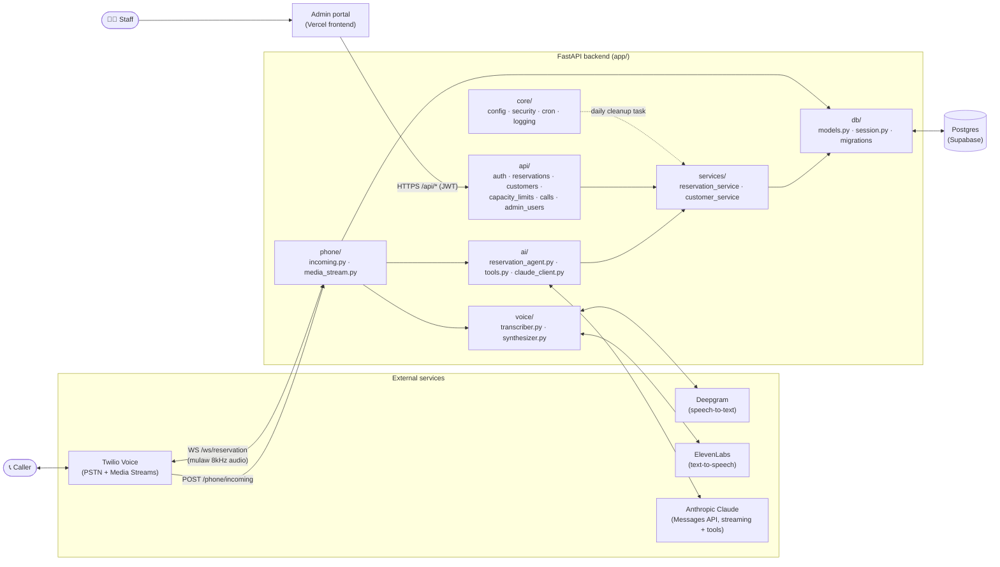
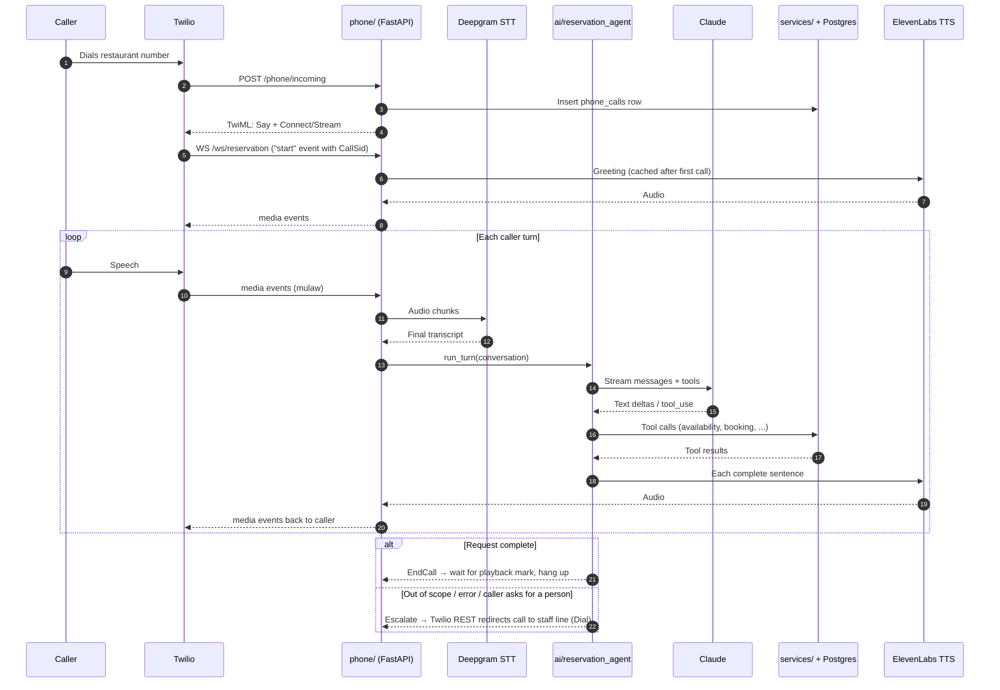

# ABC Restaurant Backend

FastAPI backend implementing `backend_design.md`: Twilio phone gateway (media
streams), a Claude-driven reservation agent, and REST APIs for the admin
portal. Persistence is Postgres (Supabase).

## System architecture

A single FastAPI process serves two very different clients: Twilio (inbound
phone calls, over a webhook plus a bidirectional media-stream WebSocket) and
the staff admin portal (JWT-authenticated REST under `/api/*`). Both paths
share the same service layer and Postgres database.



### Layers

| Layer | Path | Responsibility |
| --- | --- | --- |
| Phone gateway | `app/phone/` | `incoming.py` answers Twilio's voice webhook (signature-verified), logs a `phone_calls` row, and returns TwiML that opens a media stream. `media_stream.py` runs the per-call WebSocket loop: forwards caller audio to STT, feeds final transcripts to the agent, streams TTS audio back, guards against echo, and hangs up or transfers to staff via the Twilio REST API. |
| Voice | `app/voice/` | Pluggable `Transcriber` / `Synthesizer` interfaces. Deepgram (streaming STT) and ElevenLabs (streaming TTS) are implemented; AssemblyAI / Cartesia are stubs. Audio stays mulaw/8kHz end to end, so no transcoding. |
| AI agent | `app/ai/` | `reservation_agent.run_turn` builds the system prompt (date calendar, opening hours, caller ID), streams Claude's reply sentence-by-sentence to TTS, and executes tool calls. `tools.py` defines the tools Claude can call (`find_customer`, `check_availability`, `create_reservation`, `find_reservations`, `modify_reservation`, `cancel_reservation`, `escalate_to_staff`, `end_call`) and pins every call to the caller's own phone number. |
| Admin API | `app/api/` | REST endpoints for the staff portal — see [`docs/api.md`](docs/api.md). JWT auth with `manager` / `staff` roles. |
| Services | `app/services/` | Business rules shared by the agent and the admin API: opening hours, capacity checks (serialized with a Postgres advisory lock), reservation CRUD, customer lookup. `notification_service.py` (SMS/email confirmations) exists but is not currently wired in. |
| Core | `app/core/` | Settings from env (`config.py`), JWT + Twilio signature verification (`security.py`), logging, and the in-process 24h reservation cleanup loop (`cron.py`). |
| Data | `app/db/` | SQLAlchemy async models and session, Alembic migrations. Tables: `customers`, `reservations`, `capacity_limits`, `phone_calls`, `admin_users`. |

### Call flow



### Deployment

- **Backend**: deployed to Render. The GitHub Actions workflow
  (`.github/workflows/tests.yml`) runs `pytest` against a Postgres 16 service
  container on every PR and push to `main`; pushes to `main` that pass then
  trigger the Render deploy hook pinned to that commit.
- **Database**: Postgres on Supabase, schema managed by Alembic.
- **Admin frontend**: separate app on Vercel, allowed via
  `CORS_ALLOWED_ORIGINS`.
- **Twilio**: the phone number's voice webhook points at
  `{PUBLIC_BASE_URL}/phone/incoming`.

## Setup

```bash
python -m venv .venv && source .venv/bin/activate
pip install -r requirements.txt
cp .env.example .env   # fill in Twilio / Anthropic / STT / TTS / DB creds
```

Create the database, then run migrations:

```bash
alembic upgrade head
```

Run the app:

```bash
uvicorn app.main:app --reload
```

Run tests (reservation-service tests need a real reachable Postgres — they
skip automatically otherwise):

```bash
pytest
```

## Notes

- Reservations older than 7 days (by `starts_at`) are purged automatically:
  the app starts a background task on boot (`app/core/cron.py`) that runs
  the cleanup every 24 hours for as long as the uvicorn process is up, so no
  external scheduler is required. If you'd rather run it from an OS-level
  cron/CronJob instead, `python -m app.scripts.delete_old_reservations` does
  the same cleanup as a one-shot command.

- `app/voice/transcriber.py` (Deepgram) and `app/voice/synthesizer.py`
  (ElevenLabs) are wired up for real, using mulaw/8kHz in both directions so
  no audio transcoding is needed between Twilio and either vendor. Set
  `DEEPGRAM_API_KEY`, `ELEVENLABS_API_KEY`, and `ELEVENLABS_VOICE_ID` in
  `.env`. AssemblyAI/Cartesia are left as stubs if you want to prototype the
  alternative per design doc §7.1.
- Booking is capacity-based, not table-based: a reservation fits if the sum
  of overlapping confirmed party sizes plus the new party stays within the
  effective capacity. That's `RESTAURANT_DEFAULT_CAPACITY` (env, default 50)
  unless a staff-defined `capacity_limits` window overlaps the slot — manage
  those via the `/api/capacity-limits` admin endpoints (lowest cap wins when
  windows overlap). Writers serialize through a Postgres advisory lock in
  `reservation_service`, so concurrent calls can't oversell the last seats.
- The agent never asks callers to pick a table; it asks for any notes
  (allergies, occasions) and stores them on the reservation as
  `special_requests`.
- Opening hours are enforced in `reservation_service.closed_reason` and
  configured via env: closed all day on `RESTAURANT_CLOSED_DAYS` (default
  sunday); bookings must start within lunch (`RESTAURANT_LUNCH_OPEN`-
  `RESTAURANT_LUNCH_CLOSE`, default 11:00-14:30) or dinner
  (`RESTAURANT_DINNER_OPEN` through `RESTAURANT_LAST_BOOKING`, default
  17:00-20:45). The agent knows these hours and apologizes instead of
  booking. It also knows upstairs seating is dinner-only and asks for the
  caller's name (stored on the customer record) before booking.
